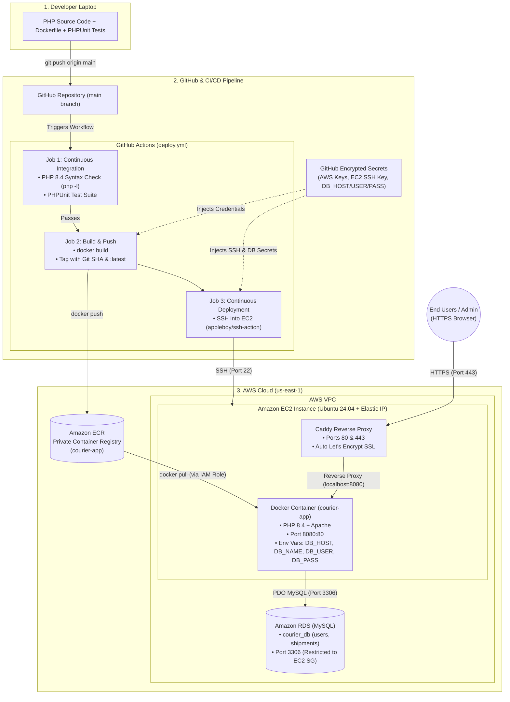

# Freight Center Logistics — Production-Grade Courier Web Application

A containerized PHP courier and shipment tracking web application built with **PHP 8.4**, **Apache**, **MySQL (Amazon RDS)**, and **Bootstrap 5**, deployed automatically to **AWS EC2** via **Docker**, **Amazon ECR**, and **GitHub Actions CI/CD**.

---

## Table of Contents
1. [Architecture Overview](#architecture-overview)
2. [Tech Stack](#tech-stack)
3. [Project Structure](#project-structure)
4. [Local Development with Docker](#local-development-with-docker)
5. [Database Setup (MySQL / Amazon RDS)](#database-setup-mysql--amazon-rds)
6. [AWS Infrastructure Setup](#aws-infrastructure-setup)
7. [GitHub Actions CI/CD Pipeline](#github-actions-cicd-pipeline)
8. [HTTPS & Custom Domain (Caddy)](#https--custom-domain-caddy)
9. [Security Practices](#security-practices)

---

## Architecture Overview

Every push to the `main` branch triggers an automated pipeline that lints and tests the PHP codebase, builds a production Docker image, pushes it to Amazon ECR, and performs a zero-downtime container swap on AWS EC2.



---

## Tech Stack

* **Backend:** PHP 8.4 (PDO MySQL, Session Management with 10-minute inactivity timeout)
* **Web Server:** Apache 2.4 (inside official `php:8.4-apache` container)
* **Frontend:** Bootstrap 5.3, Font Awesome 6.5, DataTables, SweetAlert
* **Database:** MySQL 8.0 on Amazon RDS
* **Containerization:** Docker
* **CI/CD:** GitHub Actions
* **Cloud Infrastructure:** AWS EC2 (Ubuntu 24.04 LTS), Amazon ECR, Amazon RDS, AWS IAM
* **Reverse Proxy & SSL:** Caddy (Automatic Let's Encrypt HTTPS)

---

## Project Structure

```text
├── .github/
│   └── workflows/
│       └── deploy.yml          # Automated CI/CD pipeline (Test, Build, Push to ECR, Deploy to EC2)
├── backend/
│   ├── conn.php                # Environment-driven PDO database connection
│   ├── index.php               # Admin login page
│   ├── home.php                # Responsive admin dashboard & tracking overview
│   ├── header.php              # Shared navbar, styles, & session timeout guard
│   ├── sidebar.php             # Responsive navigation sidebar partial
│   ├── footer.php              # Shared footer & JS bundles
│   └── logout.php              # Secure session & cookie termination
├── tests/                      # PHPUnit test suite
├── schema.sql                  # Clean MySQL database schema & seed admin user
├── Dockerfile                  # Production PHP 8.4 + Apache container definition
├── .dockerignore               # Excludes local files & secrets from Docker builds
└── .gitignore                  # Excludes vendor/, .env, and IDE files from Git
```

---

## Local Development with Docker

### Prerequisites
* [Docker Desktop](https://docker.com) installed
* A local or remote MySQL instance

### Build and Run Locally
1. **Clone the repository:**
   ```bash
   git clone https://github.com
   cd courier-app
   ```

2. **Build the Docker image:**
   ```bash
   docker build -t courier-app .
   ```

3. **Run the container with environment variables:**
   ```bash
   docker run -d \
     --name courier-app \
     -p 8080:80 \
     -e DB_HOST="127.0.0.1" \
     -e DB_NAME="courier_db" \
     -e DB_USER="root" \
     -e DB_PASS="your_password" \
     courier-app
   ```

4. **Access the application:**
   * Public Tracking Portal: `http://localhost:8080`
   * Admin Panel: `http://localhost:8080/backend/`

---

## Database Setup (MySQL / Amazon RDS)

1. Create a database named `courier_db` with `utf8mb4` collation:
   ```sql
   CREATE DATABASE IF NOT EXISTS courier_db CHARACTER SET utf8mb4 COLLATE utf8mb4_unicode_ci;
   ```

2. Import the schema from `schema.sql`:
   ```bash
   mysql -h YOUR_RDS_ENDPOINT -u admin -p courier_db < schema.sql
   ```

3. **Default Admin Credentials (Change immediately in production):**
   * **Username:** `admin`
   * **Password:** `admin123`

---

## AWS Infrastructure Setup

### 1. Amazon ECR
* Create a private repository named **`courier-app`** in `us-east-1`.
* (Recommended) Add a lifecycle policy to retain only the 5 most recent images.

### 2. AWS IAM
* **GitHub Actions IAM User:** Attach `AmazonEC2ContainerRegistryPowerUser` and generate programmatic access keys.
* **EC2 Instance Role:** Create an EC2 service role with `AmazonEC2ContainerRegistryReadOnly` attached so the server pulls images from ECR without storing AWS credentials on disk.

### 3. Amazon EC2 (Ubuntu 24.04 LTS)
* Attach the EC2 IAM role and associate an **Elastic IP**.
* Configure Security Group inbound rules:
  * **SSH (Port 22):** `0.0.0.0/0` (for GitHub Actions & admin access)
  * **HTTP (Port 80):** `0.0.0.0/0`
  * **HTTPS (Port 443):** `0.0.0.0/0`
* Install Docker and AWS CLI on the server (and disable any pre-installed host `apache2` service so Port 80/8080 remains free):
  ```bash
  sudo systemctl stop apache2 && sudo systemctl disable apache2
  sudo apt-get update && sudo apt-get install -y docker.io awscli mysql-client
  sudo systemctl enable --now docker
  sudo usermod -aG docker ubuntu
  ```

### 4. Amazon RDS (MySQL)
* Launch a MySQL 8 instance in the same VPC.
* Restrict Security Group inbound rule on **Port 3306** strictly to the **EC2 Instance Security Group**.

---

## GitHub Actions CI/CD Pipeline

Configure the following secrets in **GitHub Repository > Settings > Secrets and variables > Actions**:

| Secret Name | Description |
| :--- | :--- |
| `AWS_ACCESS_KEY_ID` | IAM user access key for pushing to Amazon ECR |
| `AWS_SECRET_ACCESS_KEY` | IAM user secret key |
| `EC2_HOST` | Public Elastic IP of the EC2 server |
| `EC2_USER` | SSH username (`ubuntu`) |
| `EC2_SSH_KEY` | Private ED25519 SSH key authorized on the EC2 server |
| `DB_HOST` | Amazon RDS endpoint hostname |
| `DB_NAME` | Database name (`courier_db`) |
| `DB_USER` | Database username (`admin`) |
| `DB_PASS` | Database master password |

### Branching Workflow
* Feature work and bug fixes are developed on short-lived branches (e.g., `fix/db-connection`) and opened as **Pull Requests** against `main`.
* Pull Requests run automated PHP syntax checks (`php -l`) and PHPUnit tests.
* Merging into `main` triggers the full build, ECR push, and EC2 deployment.

---

## HTTPS & Custom Domain (Caddy)

To serve the application over HTTPS with automatic Let's Encrypt SSL certificates:

1. Point your domain's DNS **A Record** to your EC2 Elastic IP.
2. Install Caddy on Ubuntu and configure `/etc/caddy/Caddyfile`:
   ```caddyfile
   yourdomain.com {
       reverse_proxy localhost:8080
   }
   ```
3. Reload Caddy (`sudo systemctl reload caddy`) and map your Docker container to `-p 8080:80` in `.github/workflows/deploy.yml`.

---

## Security Practices

* **Zero Hardcoded Credentials:** All database and cloud credentials are stored in GitHub Encrypted Secrets and injected at container runtime via environment variables.
* **Prepared Statements:** Database operations use parameterized PDO queries to prevent SQL injection.
* **Session Hardening:** Admin sessions enforce a 10-minute inactivity timeout and clear browser session cookies upon logout.
* **Network Isolation:** RDS blocks public internet access and accepts traffic exclusively from the EC2 security group.